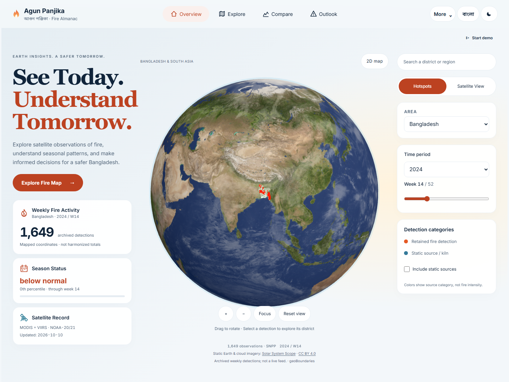
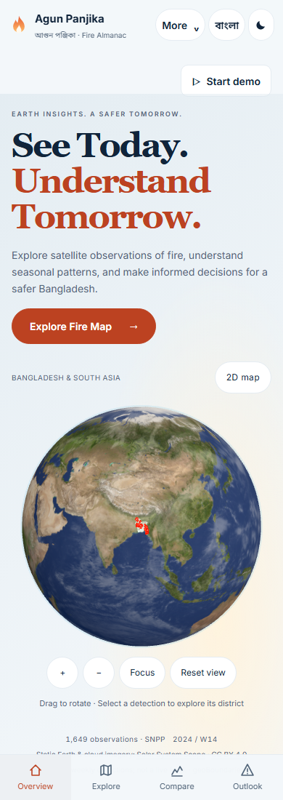
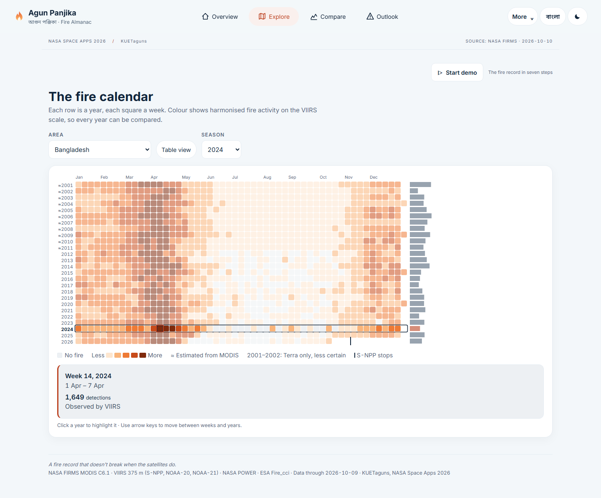
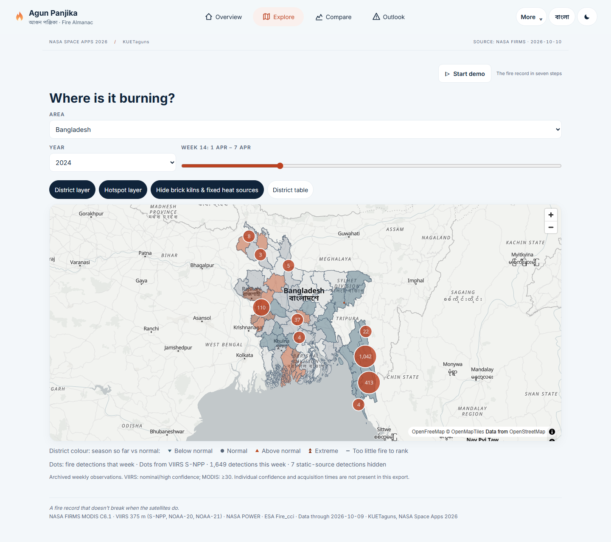
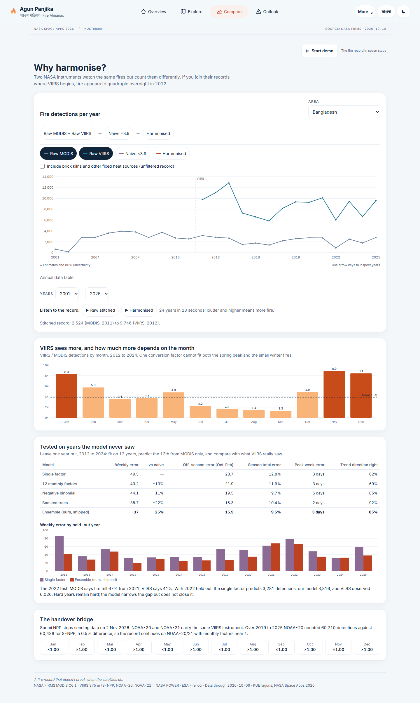
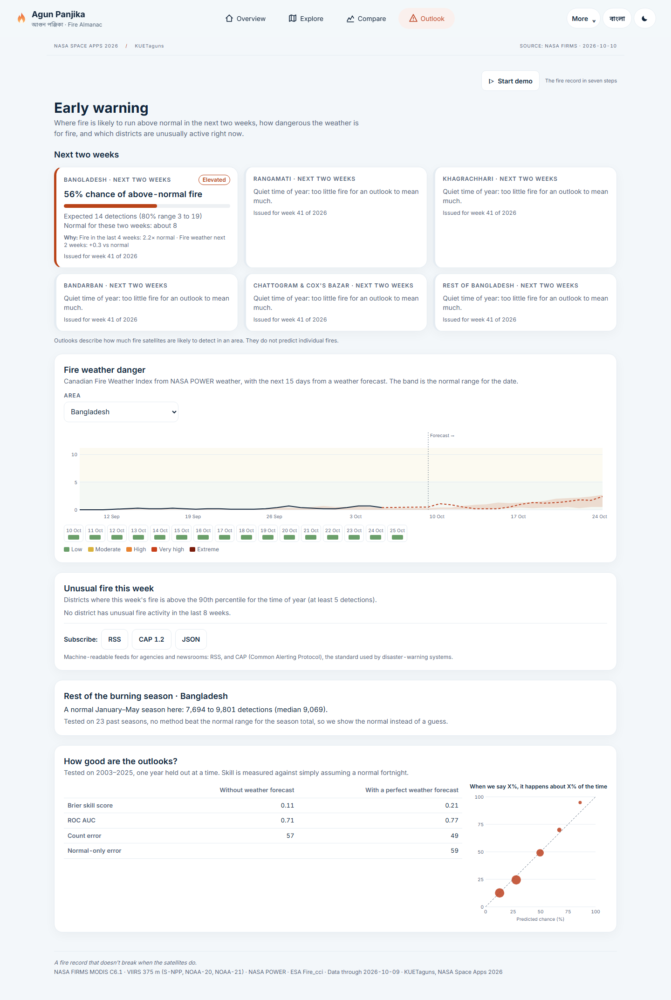
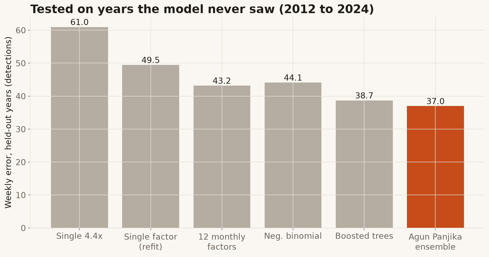
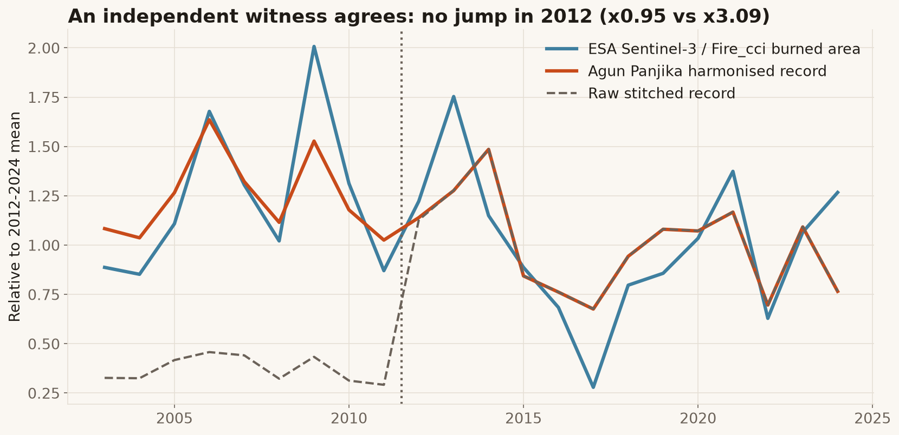
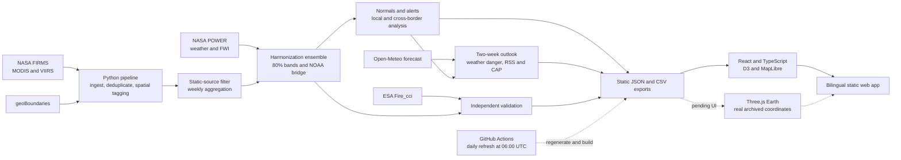

<div align="center">



# Agun Panjika · আগুন পঞ্জিকা

### One fire history. Across sensors. Across seasons.

**NASA Space Apps Challenge 2026** · **Team KUETaguns**
KUET, Khulna, Bangladesh · *Harmonization of MODIS and VIIRS Hot Spots*

   

[Overview](#project-overview) · [Preview](#application-preview) · [Science](#scientific-methodology) · [Run locally](#getting-started) · [Research](#data-sources-and-research)

<sub>Actual application capture from <code>feat/soft-earth-globe-home</code>. This interface is a pending feature preview.</sub>

</div>

> **Branch availability:** The scientific pipeline and premium design-system upgrade are implemented on `main`. This README showcases the latest working `feat/soft-earth-globe-home` interface. Its gallery remains a branch preview until Soft Earth is integrated; application upgrades are being reviewed separately. [README history](https://github.com/Rockstatata/Agun-Panjika/pull/1) · [Current merge status](https://github.com/Rockstatata/Agun-Panjika/pulls?q=is%3Apr).

## Project overview

NASA's MODIS and VIIRS instruments observe the same landscape with different sensitivity: MODIS uses approximately 1 km pixels; VIIRS uses 375 m pixels. Joining their raw counts creates an artificial jump where VIIRS begins in 2012. The difference also changes with season, so one multiplier cannot repair the record.

Agun Panjika brings those observations onto a common weekly VIIRS scale, from 2001 through the latest exported data. It helps forest officers, communities, researchers and newsrooms read Bangladesh's fire seasons, compare them with normal conditions and understand a two-week outlook—in Bangla or English, with uncertainty visible.

Continuity matters as instruments retire. NASA currently schedules the end of Suomi NPP science-data delivery for **13:00 UTC on 2 November 2026**, subject to updates. The pipeline includes a tested NOAA-20/21 bridge for the next part of the record. [NASA transition notice](https://ladsweb.modaps.eosdis.nasa.gov/alerts-and-issues/199516).

## Application preview

The **Soft Earth** homepage pairs a large textured, interactive Earth with soft blue and cream surfaces, white controls, coral accents and compact geospatial cards. Drag, zoom, focus on an area or select a real detection to explore its district. Region, year, week and static-source controls remain linked to the existing scientific views.

### Overview on mobile

<p align="center"></p>

### Explore, compare and understand the season

The gallery below uses actual captures from the same **Soft Earth production preview** as the hero. It shows the updated blue/cream surfaces, white cards, coral controls and responsive navigation across the scientific screens.

<table>
<tr>
<td width="50%"><a href="docs/readme-assets/soft-earth-calendar.png"></a><br/><b>Fire calendar</b><br/><sub>Compare seasons, select a week and distinguish observed from estimated activity.</sub></td>
<td width="50%"><a href="docs/readme-assets/soft-earth-explore.png"></a><br/><b>Explore</b><br/><sub>Inspect real weekly FIRMS points, district status and static-source filtering.</sub></td>
</tr>
<tr>
<td><a href="docs/readme-assets/soft-earth-compare.png"></a><br/><b>Compare</b><br/><sub>Follow the sensor difference, harmonized record and held-out validation.</sub></td>
<td><a href="docs/readme-assets/soft-earth-outlook.png"></a><br/><b>Outlook</b><br/><sub>Read two-week probabilities, weather danger and forecast uncertainty.</sub></td>
</tr>
</table>

Click any gallery image to inspect it at full resolution. All six screenshots are **working software captures**, not generated concepts. The desktop and mobile hero files are copied unchanged from `feat/soft-earth-globe-home`; the four scientific-screen captures come from its documented production regression run.

The Earth and clouds are **static geographic context**, credited to [Solar System Scope](https://www.solarsystemscope.com/textures/) under [CC BY 4.0](https://creativecommons.org/licenses/by/4.0/); they are not current satellite imagery or weather. Points show archived weekly FIRMS coordinates, not harmonized totals, global live fires or fire intensity.

[Getting started](#getting-started) includes local preview instructions for main, the combined upgrades and Soft Earth. The availability table below distinguishes implemented scientific features from UI changes still pending integration.

## Core features

| Capability | What it provides | Availability |
| --- | --- | --- |
| Harmonized MODIS/VIIRS history | Weekly VIIRS-scale values, calibrated 80% bands and NOAA-20/21 continuity | Implemented on `main` |
| Fire calendar | Year × week heatmap; estimated years marked ≈; supported local calendars | Implemented on `main`; selection polish pending |
| Sensor comparison | Raw, naive and harmonized series, monthly ratios, validation and sonification | Implemented on `main`; chart polish pending |
| Seasonal alerts | Percentiles against historical normals for the selected geography and period | Implemented on `main` |
| Early warning / outlook | Two-week probabilities, 15-day fire-weather danger, district anomalies, bilingual RSS and CAP 1.2 feeds | Implemented on `main` |
| NASA geospatial data and filters | FIRMS points and district choropleths; country, region, district, year and week selection | Implemented on `main`; map exploration upgrades pending |
| Static-source filtering | Brick kilns and other fixed heat sources excluded by default, with an inclusion switch | Implemented on `main` |
| Cross-border analysis | CHT with Tripura, Mizoram and Chin State; upwind burning alongside Dhaka aerosol | Implemented on `main` |
| Bilingual experience | English/Bangla, light/dark themes, responsive layouts and cached offline resources | Implemented on `main`; navigation, accessibility and recovery upgrades pending |
| Reports and exports | PNG share cards, printable season reports, CSV downloads and citations | Implemented on `main`; failure handling pending |
| Interactive geographic Earth | Canvas sphere with real-coordinate selection and 2D fallback | Pending in `feat/3d-geospatial-experience` |
| Realistic Soft Earth | Lazy Three.js globe, licensed textures, linked controls and resilient 2D fallback | Pending in `feat/soft-earth-globe-home`, after the eight upgrades |
| Guided presentation | Optional bilingual seven-step demo that restores the user's filters | Pending in `feat/demo-storytelling` |

Geographic coverage includes Bangladesh, five regions, 64 districts, and supported local calendars for 25 upazilas and 124 unions in the Chittagong Hill Tracts. The country-configurable pipeline also has a Nepal example. Geographic context extends beyond Bangladesh; the Soft Earth observation layer contains Bangladesh detections.

## Scientific methodology

The pipeline normalizes and deduplicates FIRMS detections, applies confidence/type and static-source filters, assigns geography, then aggregates by region and ISO week. MODIS counts, fire radiative power, platform/day-night composition, pixel geometry and NASA POWER weather help explain how the instruments differ.

The shipped harmonization ensemble combines **30% negative binomial regression** with **70% bagged LightGBM Poisson predictions** across five seeds. Models learn from the **2012–2025 overlap**, with leave-one-year-out evaluation. Held-out errors calibrate conformal 80% uncertainty bands. The reconstruction covers MODIS-only 2003–2011; a separate, lower-confidence Terra-only model covers 2001 through 2002-W26.

| Repository validation result | Evidence |
| --- | --- |
| Ensemble weekly error **37.0**, versus **61.0** for the PRD 4.4× factor and **49.5** for a factor refit per fold | [validation.json](web/public/data/validation.json): −39% and −25%, respectively |
| Off-season improvement in **14 / 14** held-out years | Same validation export; comparison with the refit factor |
| **81%** national-week coverage and **86%** national-year coverage for nominal 80% bands | Same export: 0.813 and 0.857 |
| **0.95×** versus **3.09×** at the 2012 switch; estimated-year correlation **0.93**, seasonal-cycle correlation **0.98** | [partner.json](web/public/data/partner.json): independent ESA burned-area check |
| **54,669** MODIS detections, 2003–2021 | [Count regression](tests/test_pipeline.py), matching Farukh et al. 2023 |
| NOAA-20 **4.6%**, NOAA-21 **10.8%** held-out season-total error | [bridge.json](web/public/data/bridge.json): identity bridge outperforms fitted factors |
| Static-source precision **80%** in the final sample | [Round 3](docs/kiln_spotcheck_round3.csv): 16 of 20 cells confirmed industrial; 60 images checked over three rounds |

These are existing repository results, not new measurements from the UI redesign. Reproduction lives in [validation.ipynb](notebooks/validation.ipynb) and [figures.py](notebooks/figures.py).

<details>
<summary><b>Model comparison, uncertainty and validation figures</b></summary>

| Model | Weekly error | vs PRD 4.4× | vs refit factor | Off-season error | Off-season years beating factor | Season total error | Peak-week error | Trend direction |
| --- | --: | --: | --: | --: | :--: | --: | --: | --: |
| PRD single factor 4.4× | 61.0 | — | +23% | 26.1 | — | 20.2% | 3.0 d | 61% |
| Single factor, refit per fold (≈3.9) | 49.5 | −19% | — | 28.7 | — | 12.8% | 3.0 d | 61% |
| 12 monthly factors | 43.2 | −29% | −13% | 21.9 | 11 / 14 | 11.9% | 3.0 d | 69% |
| Negative binomial | 44.1 | −28% | −11% | 19.5 | 13 / 14 | 9.7% | 5.0 d | 85% |
| LightGBM, bagged | 38.7 | −37% | −22% | 15.3 | 14 / 14 | 10.4% | 2.0 d | 92% |
| **Ensemble** | **37.0** | **−39%** | **−25%** | **15.9** | **14 / 14** | **9.5%** | **3.0 d** | **85%** |

Terra-only reconstruction has 33% less weekly error than its single-factor baseline. The documented Nepal run reports −22% versus a refit factor, −60% versus 4.4×, improvement in 13 / 13 off-season years and 81% coverage; these are country-specific results, not a global guarantee.

<p> </p>

ESA burned area measures area, not detection counts. Its role is to check agreement in seasonal timing and year-to-year change.

</details>

**Early warning.** A LightGBM classifier estimates the probability that the next two weeks exceed normal; a Poisson model supplies expected counts and conformal ranges. Fire-history features combine with Canadian Fire Weather Index (FWI) history and forecast weather. District alerts flag weeks above the historical 90th percentile, with at least five detections.

| Hindcast, 2003–2025 | Brier skill vs normal | ROC AUC | Count error |
| --- | --: | --: | --: |
| Fire history only | 0.11 | 0.71 | 57.2 |
| Perfect two-week FWI forecast, **upper bound** | 0.21 | 0.77 | 49.2 |

The normal-only count error is 59.3. The upper-bound experiment assumes perfect future weather; it is **not operational forecast accuracy**. Rain, soil wetness and ENSO added no skill in these experiments. Weeks in the driest fifth of FWI anomaly had 1.65× normal fire. No tested season-total method beat the normal range (Brier skill 0.04), so the app shows that range. See [forecast.json](web/public/data/forecast.json) and [forecast.py](pipeline/forecast.py).

**Static sources.** The kiln filter flags approximately 400 m cells active across many months and years outside the jhum season, then adds predominantly night-time activity and at least ten detections. Successive fresh 20-cell image checks yielded 60%, 75% and 80% precision. Unclear cells remain uncertainty; filtered detections can be included in the interface. [Inspection records](docs/kiln_spotcheck_round3.csv) · [Examples and imagery credits](docs/figures/12_kiln_examples.jpg).

## Technology and architecture

The application serves precomputed files: **no database or live application server**. Python supplies static JSON, CSV and XML to a React 18 / TypeScript / Vite frontend. D3 powers scientific charts; MapLibre GL powers the map. Three.js belongs to the pending Soft Earth interface.



The [daily workflow](.github/workflows/daily.yml) runs the pipeline, Python tests and frontend build, then deploys through GitHub Pages on `main`. Check [Actions](https://github.com/Rockstatata/Agun-Panjika/actions) and the dataset timestamp to verify refresh success. Refresh and deployment require successful pipeline, test and build steps. Branch pushes have no separate preview deployment configured.

<details>
<summary><b>Repository map</b></summary>

```text
Agun-Panjika/
├── pipeline/           Ingest, geography, kilns, weather, harmonization,
│                       bridge, climatology, forecasts, exports and neighbours
│   ├── countries/      Country configurations, including Nepal
│   └── schema/         Exported region-document schema
├── web/
│   ├── src/screens/    Home, Outlook, Calendar, Sensors, Map, Borders, Method
│   ├── src/i18n/       English and Bangla translations
│   └── public/data/    Committed JSON, CSV and alert feeds
├── tests/              Scientific, schema, forecast and contrast checks
├── notebooks/          Validation and reproducible figures
├── docs/               Product specification, research and screenshots
│   └── readme-assets/  Isolated, unchanged Soft Earth preview captures
└── .github/workflows/  Daily refresh and Pages deployment
```

</details>

## Getting started

**Prerequisites:** Git, Node.js 20+ with npm, and Python 3.11+ for scientific work. The committed exports are sufficient to run the frontend; a FIRMS key and pipeline regeneration are optional for that first preview.

```bash
git clone https://github.com/Rockstatata/Agun-Panjika.git
cd Agun-Panjika
cd web
npm ci
npm run dev
```

Open the localhost URL printed by Vite (normally `http://localhost:5173`). To check and serve a production build:

```bash
npm run typecheck
npm run build
npm run preview
```

### Review the pending interface

From the repository root, create a separate worktree so your main checkout stays available:

```bash
git fetch origin --prune
git worktree add --detach ../agun-soft-earth-review origin/feat/soft-earth-globe-home
cd ../agun-soft-earth-review/web
npm ci
npm run dev -- --host 127.0.0.1 --port 5282 --strictPort
```

Open `http://127.0.0.1:5282`. To review the combined eight upgrades, substitute `origin/preview/agun-v2`, a different worktree name and port. To review one upgrade, use its exact `origin/feat/...` ref. These are local previews; no merge is required.

### Scientific pipeline and environment

From the repository root:

```bash
python -m venv .venv
# Activate .venv using your shell, then:
python -m pip install -e ".[dev]"
python -m pipeline.run_all --help
python -m pytest -q
```

Activate with `.venv\Scripts\Activate.ps1` in PowerShell or `source .venv/bin/activate` in bash on macOS/Linux.

For fresh FIRMS API data, obtain a [free map key](https://firms.modaps.eosdis.nasa.gov/api/map_key/). Create or edit the **gitignored root `.env`** without replacing any existing configuration:

```dotenv
FIRMS_MAP_KEY=your_key_here
```

No frontend environment file is required. Keep the key on the pipeline side. The loader reads `.env`; existing environment variables take precedence, and FIRMS request logs redact the key.

```bash
# Refresh archives and APIs, scientific exports and cross-border views
python -m pipeline.run_all --api-since 2025-01-01 --neighbours

# Archive-only run without a FIRMS API key
python -m pipeline.run_all

# Reproduce scientific figures after the required inputs are available
python notebooks/figures.py
```

A full pipeline run downloads substantial external inputs and rewrites generated exports. Archive-only coverage ends in 2024; 2025 onward and NOAA-21 require the API. First-run downloads were documented at about 1.3 GB; runtime depends on network, caches and compute. Missing optional raw/intermediate inputs cause some Python tests to skip: report skips alongside passes.

<details>
<summary><b>Another country and deployment configuration</b></summary>

Use [the Nepal configuration](pipeline/countries/npl.json) as a template. In bash:

```bash
AP_COUNTRY=pipeline/countries/npl.json python -m pipeline.run_all
```

In PowerShell:

```powershell
$env:AP_COUNTRY = 'pipeline/countries/npl.json'
python -m pipeline.run_all
Remove-Item Env:AP_COUNTRY
```

Outputs go to `build/<iso3>/data/`, separated from Bangladesh. Local calendars and the ESA check are Bangladesh-specific.

For the existing Pages workflow, configure the repository secret `FIRMS_MAP_KEY` and choose **GitHub Actions** as the Pages source. Scheduled refresh is 06:00 UTC (12:00 Asia/Dhaka); successful deployment depends on the pipeline, tests, build and repository permissions. Historical source downloads are cached.

</details>

## Data sources and research

| Source | Role |
| --- | --- |
| [NASA FIRMS](https://firms.modaps.eosdis.nasa.gov/) · MODIS C6.1 Terra/Aqua, VIIRS 375 m S-NPP / NOAA-20 / NOAA-21 | Country archives and area API; long baseline, reference scale and continuity bridge |
| [NASA POWER](https://power.larc.nasa.gov/) | Weather covariates, fire-weather history and Dhaka aerosol context |
| [ESA Fire_cci](https://climate.esa.int/en/projects/fire/) · [CEDA archive](https://catalogue.ceda.ac.uk/) | MRBA v6.0 (2003–2018) and Sentinel-3 SYN v1.1 (2019–2024) burned-area checks |
| [geoBoundaries gbOpen](https://www.geoboundaries.org/) · CC BY 4.0 | District, upazila and union tagging |
| [Open-Meteo](https://open-meteo.com/) | Weather forecasts used for the 15-day danger outlook |
| [NOAA CPC ONI](https://www.cpc.ncep.noaa.gov/products/analysis_monitoring/ensostuff/ensoyears.shtml) | ENSO covariate tested in outlook experiments |
| [OpenFreeMap](https://openfreemap.org/), [OpenMapTiles](https://openmaptiles.org/), [OpenStreetMap](https://www.openstreetmap.org/copyright) | Map basemap and attribution |
| [Solar System Scope](https://www.solarsystemscope.com/textures/) · [CC BY 4.0](https://creativecommons.org/licenses/by/4.0/) | Static Earth/cloud textures in the pending Soft Earth preview |

India and Myanmar FIRMS files supply cropped cross-border and upwind views. Kiln-check imagery credits remain **Esri, Maxar and Earthstar Geographics**.

Research retained from the project:

- Farukh, Islam & Hayasaka (2023), *Wildland Fires in the Subtropical Hill Forests of Southeastern Bangladesh*, **Atmosphere 14(1):97**. [Article](https://www.mdpi.com/2073-4433/14/1/97).
- Zheng et al. (2026), *Fire Radiative Power Correction and Spatiotemporal Fusion Based on MYD14 and VNP14IMG*, **Remote Sensing 18(10):1650**. [Article](https://www.mdpi.com/2072-4292/18/10/1650). Prior sensor-fusion research; its FRP fitting scores are not Agun Panjika validation scores.
- Van Wagner (1987), *Development and Structure of the Canadian Forest Fire Weather Index System*. [Canadian Forest Service report, hosted by Harvard](https://courses.seas.harvard.edu/climate/eli/Courses/global-change-debates/Sources/Forest-fires/aridity-indices/Van-Wagner-1987-canadian-fire-weather-index.pdf).

The [product requirements](docs/Agun%20Panjika%20%E2%80%94%20Product%20Requirements%20Document.md) retain the wider Bangladesh research context and supporting citations.

## Limitations

- **Observed versus estimated:** 2001–2011 values are estimates with 80% bands. Terra-only 2001–2002 values have lower confidence. NOAA-bridged values retain their source labels.
- **Peak weeks:** the year-to-year peak VIIRS/MODIS ratio varies from 2.9× to 7.1×. MODIS cannot fully explain that variation; peak weeks remain difficult.
- **Forecast uncertainty:** outlooks describe aggregate satellite detections in an area, not individual fire ignition. Perfect-weather hindcast skill is an upper bound. Season totals use the normal range.
- **Small areas:** upazila and union values are apportioned from district records. Read seasonal patterns rather than individual weeks.
- **Scope and attribution:** the project does not monitor the Sundarbans and does not establish that hill fires or upwind burning cause Dhaka haze. Cross-border timing is not causal attribution.
- **Imagery and freshness:** textured Earth/cloud layers are static. Point exports lack FRP, confidence and acquisition timestamps; colors identify source category. Consult exported timestamps before treating a view as current.
- **Offline and accessibility:** offline use requires previously cached same-origin resources; external fonts and tiles may be unavailable. Browser accessibility checks do not replace physical-device or assistive-technology review.
- **Language and release review:** Bangla strings and union names still need native-speaker and CHT community review. Existing dependency advisories and refresh-workflow reliability remain release work; no compliance or production-readiness claim is made here.

## Team and acknowledgements

Built by **Team KUETaguns**, Khulna University of Engineering & Technology (KUET), Khulna, Bangladesh, for **NASA Space Apps Challenge 2026**. [Project repository and contributors](https://github.com/Rockstatata/Agun-Panjika/graphs/contributors).

Thanks to NASA FIRMS and POWER, ESA Fire_cci, the geographic and weather data maintainers, and the open-source visualization community. Data, imagery and software retain their respective licenses and attribution requirements.

```text
KUETaguns (2026). Agun Panjika: a harmonised MODIS and VIIRS fire record and early-warning system for
Bangladesh, 2001 to present. NASA Space Apps Challenge 2026. Data: NASA FIRMS, NASA POWER, ESA Fire_cci.
```

<p align="center"><sub>Made in Khulna for the hills, the forests and the cities that breathe their smoke.<br/>
<a href="docs/Agun%20Panjika%20%E2%80%94%20Product%20Requirements%20Document.md">Product specification</a> ·
<a href="docs/Agun%20Panjika%20%E2%80%94%20Video%20and%20Story%20Ideas.md">Video and story ideas</a> ·
<a href="notebooks/validation.ipynb">Validation notebook</a></sub></p>
