<div align="center">

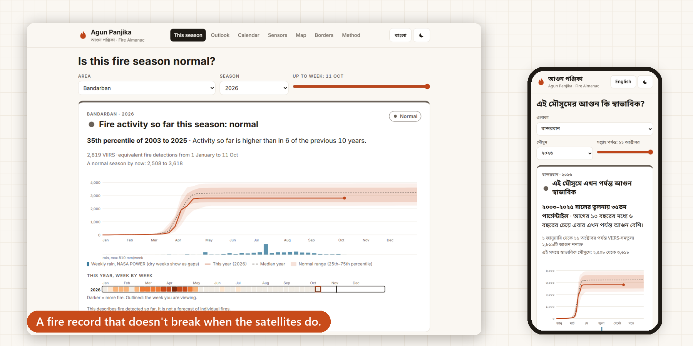

# Agun Panjika · আগুন পঞ্জিকা

### The Fire Almanac: a fire record that doesn't break when the satellites do

**NASA Space Apps Challenge 2026** · Challenge: *Harmonization of MODIS and VIIRS Hot Spots* · **Team KUETaguns**, KUET Khulna, Bangladesh


</div>

---

> **Every April the hills of Bangladesh burn. Every June they slide. Every winter the cities breathe smoke.**
> NASA's satellites watched all of it for 26 years, with two instruments that count fire very differently.
> On **2 November 2026**, one of them stops. **Agun Panjika** merges both into one weekly record from 2001 to today and carries it onto the next satellites. In Bangla and English, it tells forest officers, communities and researchers whether this fire season is normal, and what the next two weeks may bring.

<table>
<tr>
<td align="center"><b>−39%</b><br/><sub>weekly error vs the PRD's single 4.4× factor<br/>(−25% vs a factor refit on each training fold)</sub></td>
<td align="center"><b>14 / 14</b><br/><sub>held-out years where the off-season<br/>error beats the single factor</sub></td>
<td align="center"><b>0.95× vs 3.09×</b><br/><sub>the 2012 "jump", as judged by ESA's<br/>independent Sentinel-3 burned area</sub></td>
<td align="center"><b>81%</b><br/><sub>of held-out weeks fall inside<br/>our "80%" uncertainty band</sub></td>
</tr>
<tr>
<td align="center"><b>54,669</b><br/><sub>MODIS 2003–2021 count, exactly the<br/>published total (Farukh et al. 2023)</sub></td>
<td align="center"><b>80%</b><br/><sub>kiln filter precision, checked on<br/>60 satellite images (3 rounds)</sub></td>
<td align="center"><b>AUC 0.77</b><br/><sub>two-week fire outlook, hindcast<br/>2003–2025 (upper bound)</sub></td>
<td align="center"><b>124 unions</b><br/><sub>fire calendars down to union level<br/>in the Chittagong Hill Tracts</sub></td>
</tr>
</table>

## Contents

1. [The problem](#1-the-problem)
2. [What Agun Panjika does](#2-what-agun-panjika-does)
3. [The app](#3-the-app)
4. [Architecture](#4-architecture)
5. [Data sources](#5-data-sources)
6. [How the harmonisation works](#6-how-the-harmonisation-works)
7. [Is it right? Validation](#7-is-it-right-validation)
8. [Early warning](#8-early-warning)
9. [Kiln and industry filter](#9-kiln-and-industry-filter)
10. [Beyond the border](#10-beyond-the-border)
11. [Run it yourself](#11-run-it-yourself)
12. [Repository layout](#12-repository-layout)
13. [Limits](#13-limits)
14. [Credits and citation](#14-credits-and-citation)

---

## 1. The problem

NASA has two fire instruments over Bangladesh, and they disagree:

- **MODIS** (Terra, Aqua): 1 km pixels, flying since 2000.
- **VIIRS** (Suomi NPP, NOAA-20, NOAA-21): 375 m pixels, flying since 2012.

VIIRS sees about 4× more fire than MODIS in April and about 13× more in November. Join the two records where VIIRS begins, and fire seems to **quadruple overnight in 2012**, which never happened. The MODIS satellites are now retiring, and Suomi NPP's science data end at **13:00 UTC on 2 November 2026** ([NASA Earthdata](https://www.earthdata.nasa.gov/data/alerts-outages/suomi-npp-observations-cease-november-2-2026)).

<p align="center">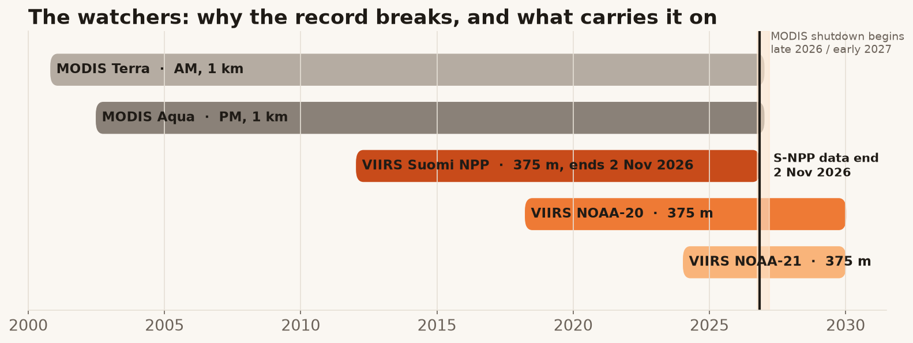</p>

<table>
<tr>
<td width="50%">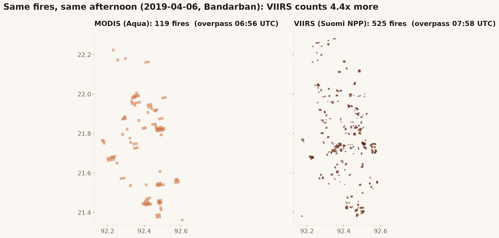<br/><sub><b>Same fires, same afternoon.</b> 6 Apr 2019, Bandarban: Aqua MODIS logged 119 fires, Suomi NPP VIIRS 525.</sub></td>
<td width="50%">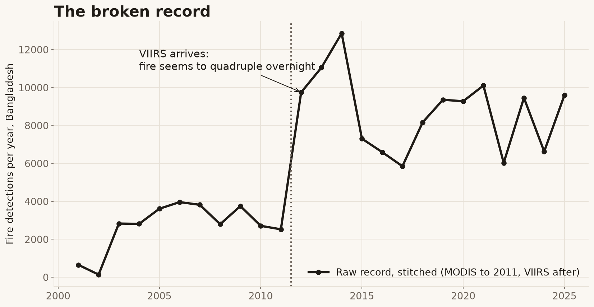<br/><sub><b>The broken record.</b> Stitching raw files makes fire "quadruple" in 2012.</sub></td>
</tr>
<tr>
<td colspan="2">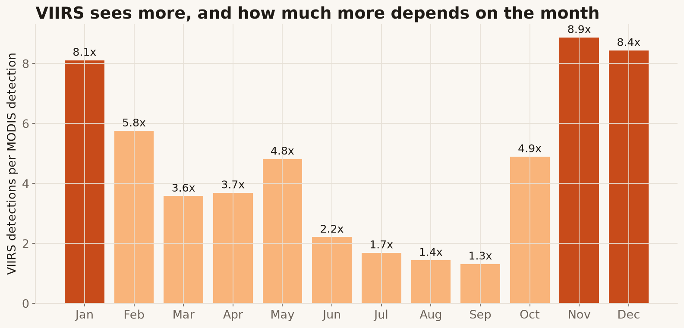<br/><sub><b>No single factor can fix it.</b> The VIIRS/MODIS ratio depends on the season, because small winter fires are seen only by VIIRS.</sub></td>
</tr>
</table>

## 2. What Agun Panjika does

| | Feature | What the user sees |
| :-: | --- | --- |
| 🔥 | **One harmonised record, 2001 to today** | Weekly fire on the VIIRS scale for the country, 5 regions, 64 districts, 25 upazilas and 124 unions, with calibrated 80% bands |
| 📅 | **The Panjika (fire calendar)** | Week × year heatmap styled like a Bengali almanac; years estimated from MODIS are marked ≈ |
| 🚦 | **Season alert in Bangla** | "Fire this season is above normal: 82nd percentile", for any area, any year, any week |
| 🛰️ | **Handover bridge** | The series continues on NOAA-20/21 after Suomi NPP stops, with no artificial jump |
| ⚠️ | **Early warning** | Two-week outlook, a 15-day fire-weather danger forecast, district anomaly alerts, and RSS / **CAP 1.2** feeds in Bangla and English |
| 🏭 | **Kiln and industry filter** | Brick kilns, gas flares and power plants removed, with an "include kilns" switch |
| 🌏 | **Fire without borders** | Chittagong Hill Tracts with Tripura, Mizoram and Chin State, and burning upwind of Dhaka against Dhaka aerosol |
| 🔊 | **Listen to the record** | 24 years of fire as sound: hear the fake 2012 jump vanish |
| 🖨️ | **Share and print** | A one-tap PNG card for WhatsApp/Facebook, and a printable one-page season report |
| 🌐 | **Any country** | Run the pipeline for any FIRMS country with one JSON config (tested on Nepal) |

## 3. The app

Seven screens, mobile-first, fully bilingual, with dark mode. They work offline after the first visit.

<table>
<tr>
<td width="62%">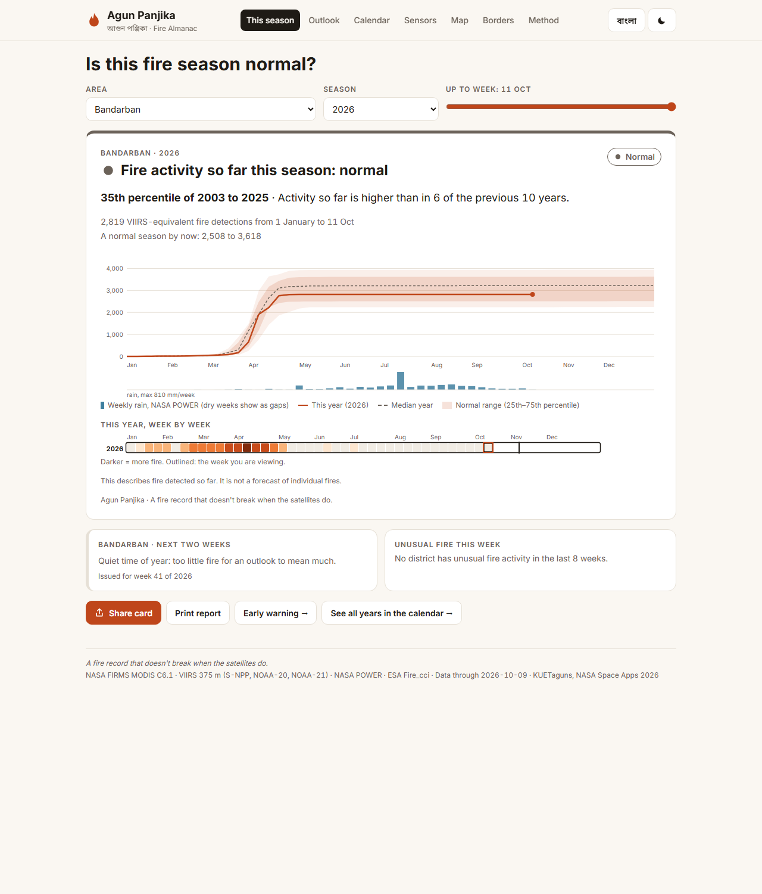<br/><sub><b>This season</b>: alert level, percentile against 2003–2025, normal band, NASA POWER weekly rain, this year week by week, two-week outlook, share and print.</sub></td>
<td width="38%">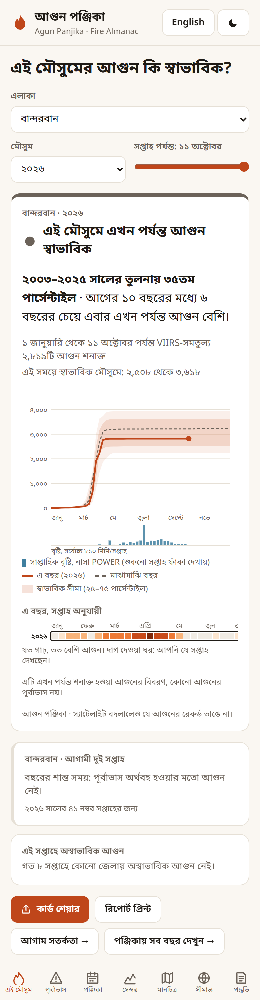<br/><sub>The same answer on a phone, in Bangla.</sub></td>
</tr>
<tr>
<td>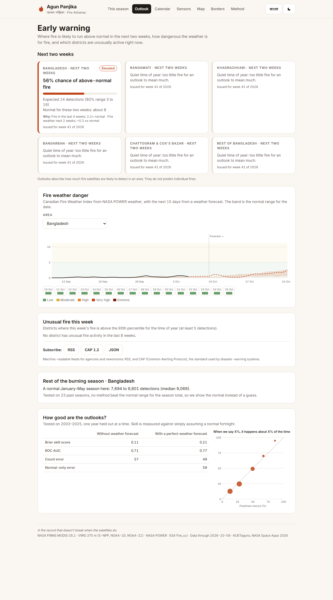<br/><sub><b>Outlook</b>: two-week outlooks, 15-day fire-weather danger, alerts, CAP/RSS feeds, and hindcast skill with a reliability diagram.</sub></td>
<td>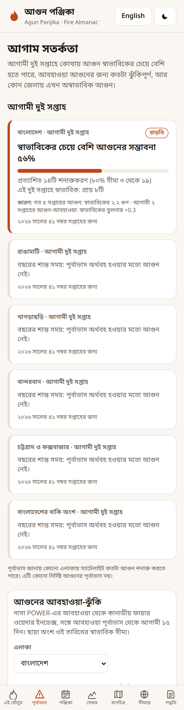<br/><sub>Early warning in Bangla.</sub></td>
</tr>
<tr>
<td>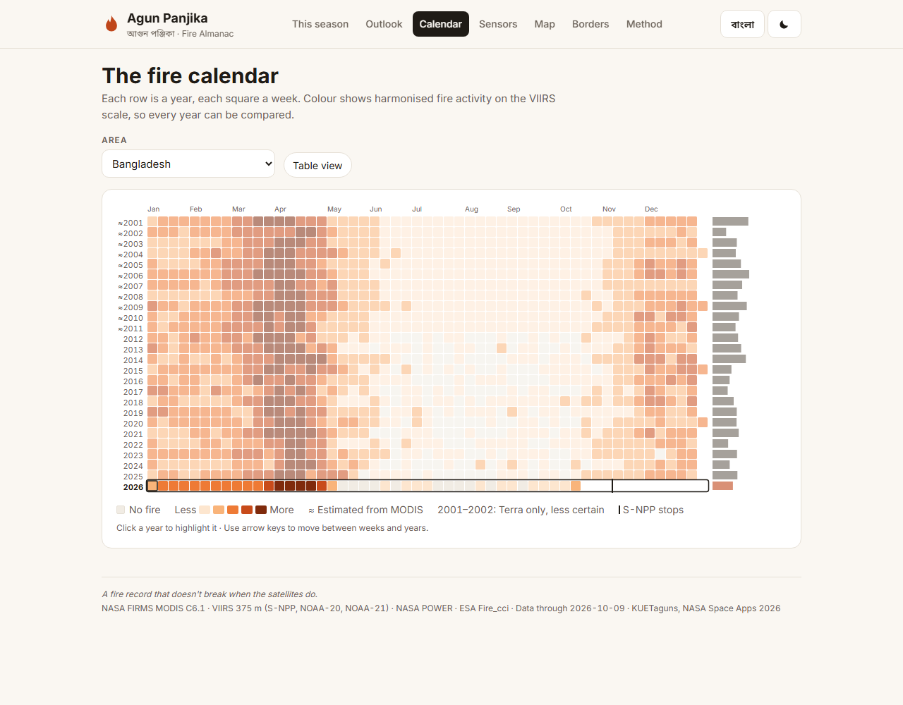<br/><sub><b>Calendar</b>: 26 fire seasons on one scale. The handover is marked in the 2026 row.</sub></td>
<td>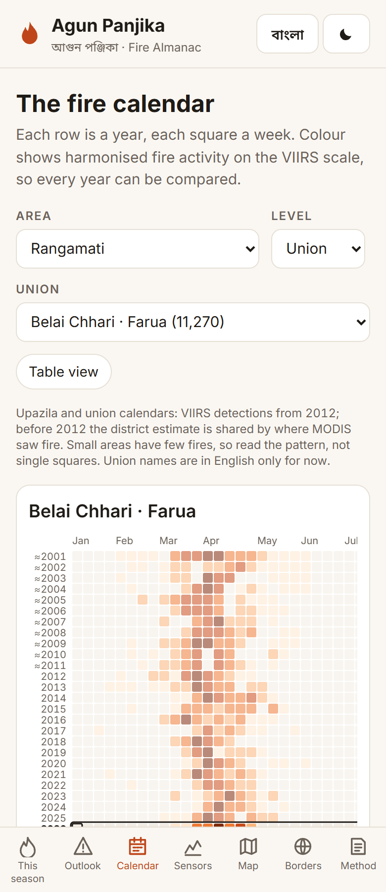<br/><sub>Down to a single union: Farua, Belaichhari.</sub></td>
</tr>
<tr>
<td>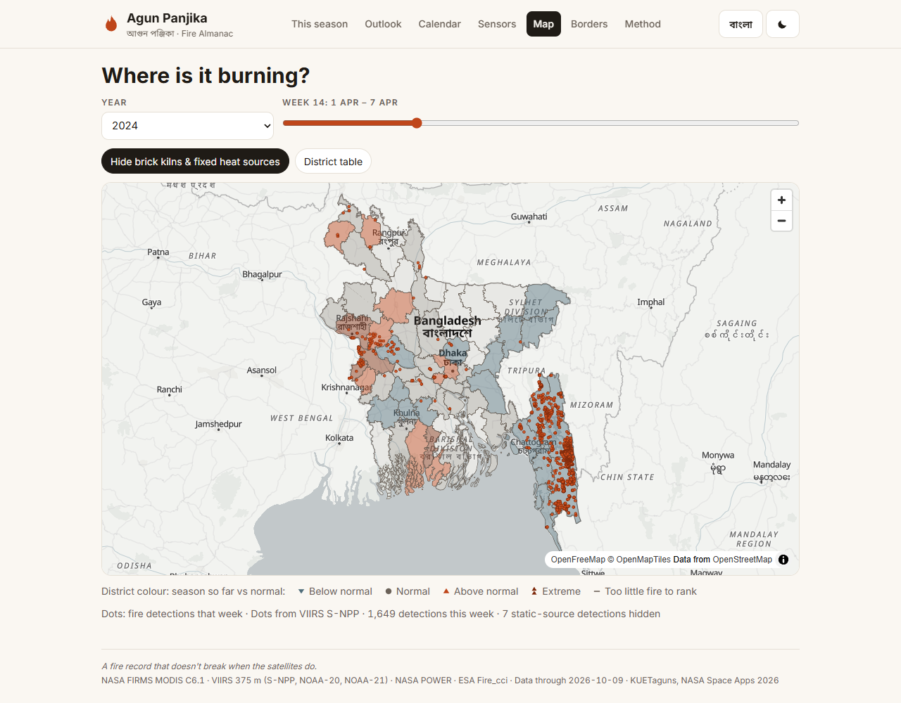<br/><sub><b>Map</b>: district percentile choropleth, weekly VIIRS detections, kiln toggle and district table.</sub></td>
<td>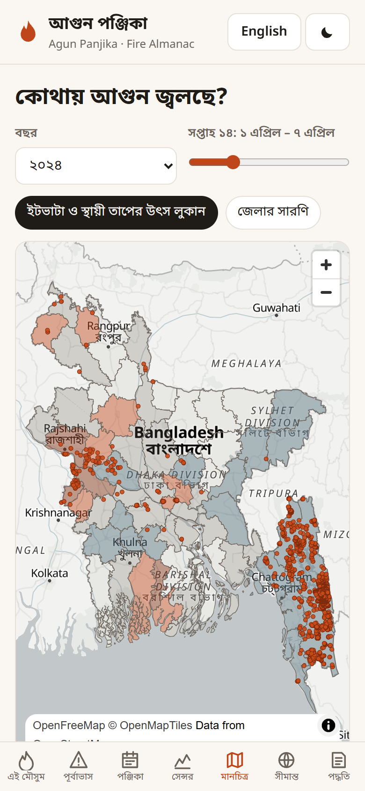<br/><sub>MapLibre with OpenFreeMap tiles, loaded only when opened.</sub></td>
</tr>
<tr>
<td>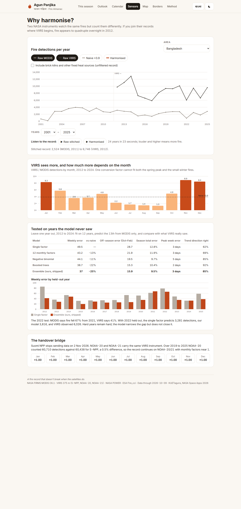<br/><sub><b>Sensors</b>: raw / naive / harmonised toggle, "listen to the record", monthly ratios, validation, the handover bridge.</sub></td>
<td>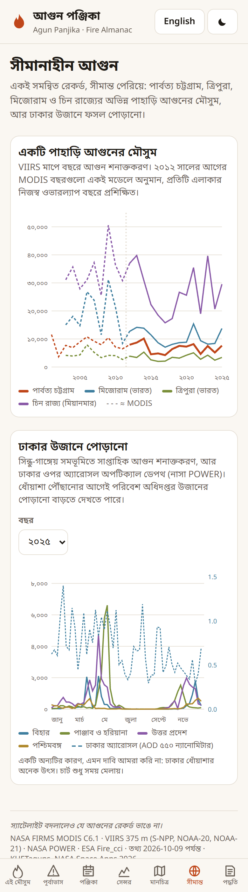<br/><sub><b>Borders</b>: one hill fire season across three countries.</sub></td>
</tr>
<tr>
<td colspan="2">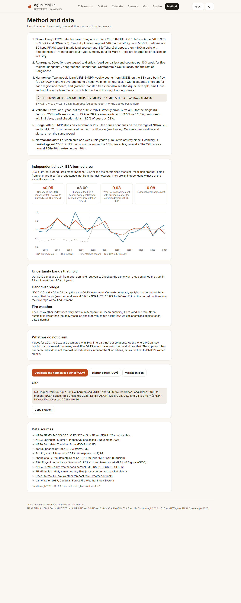<br/><sub><b>Method</b>: method, the ESA independent check, interval coverage, the bridge, limits, CSV downloads and citation.</sub></td>
</tr>
</table>

<details>
<summary><b>Dark mode and district view</b></summary>
<br/>
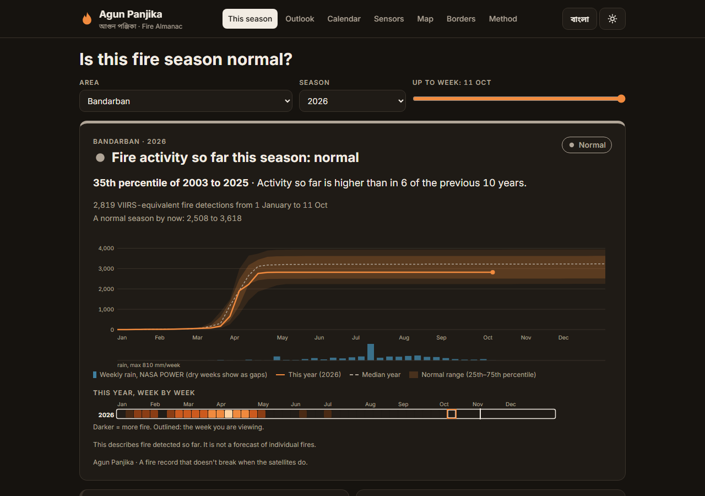 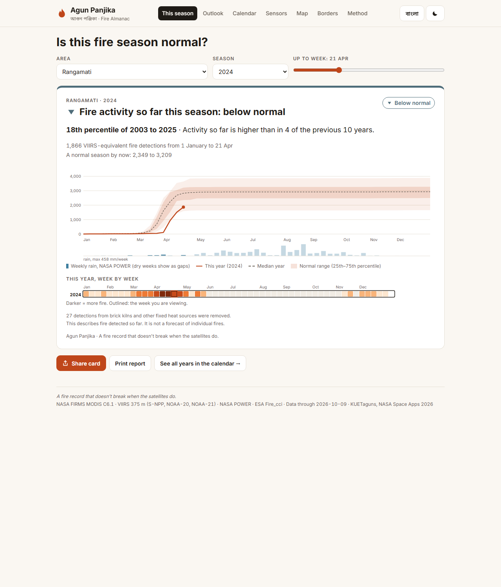
</details>

## 4. Architecture

There's no database and no live server. A Python pipeline precomputes everything into static JSON, and a static React site reads it. A GitHub Action refreshes the live season every day.

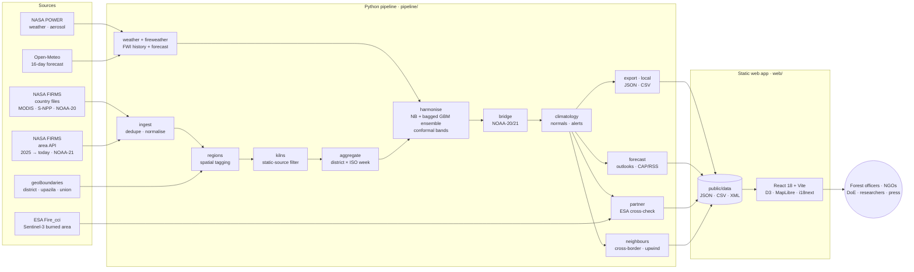

**Daily refresh** ([.github/workflows/daily.yml](.github/workflows/daily.yml)):

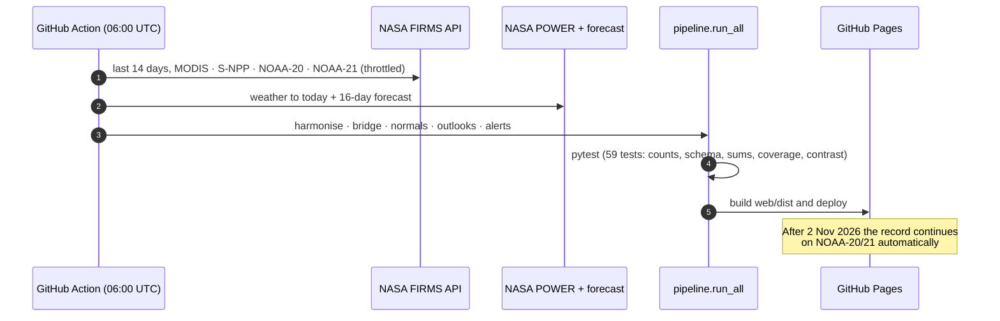

## 5. Data sources

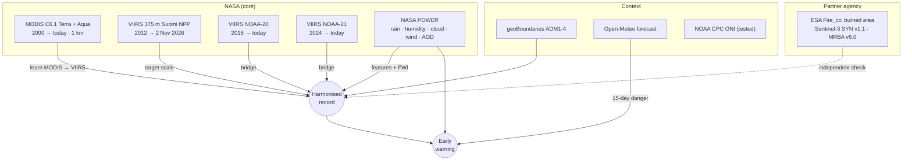

| Dataset | Years | Access | Role |
| --- | --- | --- | --- |
| NASA FIRMS MODIS C6.1 (Terra, Aqua) | 2000 → today | Country CSV + area API | Long baseline |
| NASA FIRMS VIIRS 375 m Suomi NPP | 2012 → 2 Nov 2026 | Country CSV + area API | Target scale |
| NASA FIRMS VIIRS NOAA-20 / NOAA-21 | 2018 / 2024 → today | Country CSV / area API | Handover bridge |
| FIRMS India and Myanmar country files | 2003 → today | Country CSV, cropped | Cross-border and upwind views |
| NASA POWER daily | 2001 → today | Point API (no key) | Weather features, FWI, Dhaka AOD |
| ESA Fire_cci burned area grids | 2003 → 2024 | CEDA (open) | Independent validation |
| geoBoundaries gbOpen | 2020 | API | District / upazila / union tagging |
| Open-Meteo forecast | next 16 days | API (no key) | Fire-weather outlook |

Together that is **330,000+ detections over Bangladesh**, plus about 3 million in the cross-border and upwind areas.

## 6. How the harmonisation works

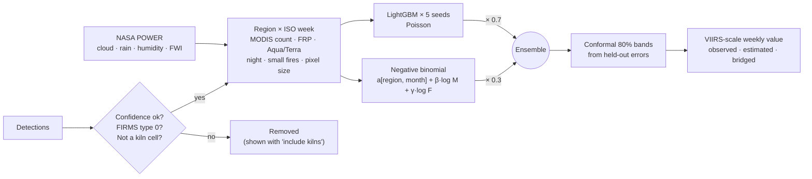

- **Training data.** The models learn on the 14 years both sensors flew (2012–2025). They are then applied to the MODIS-only years (2003–2011).
- **Terra-only years.** For 2001 to mid-2002, before Aqua, a separate Terra-only model is used. It has 33% less error than a Terra factor and is labelled lower-confidence.
- **What drives the model.** The pixel-size features are a physical insight: off-nadir MODIS pixels are up to 10× larger and miss small fires, so view geometry helps explain the VIIRS/MODIS ratio.

<table>
<tr>
<td width="50%">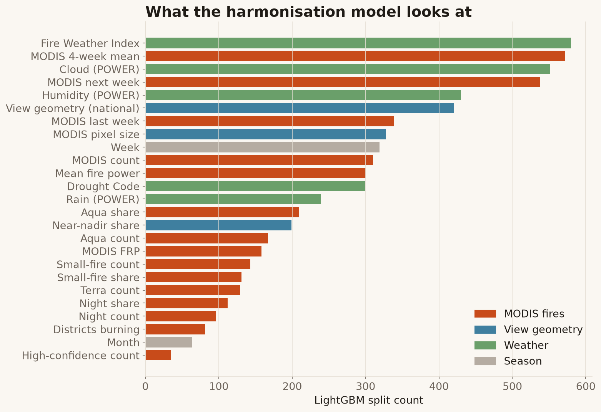</td>
<td width="50%">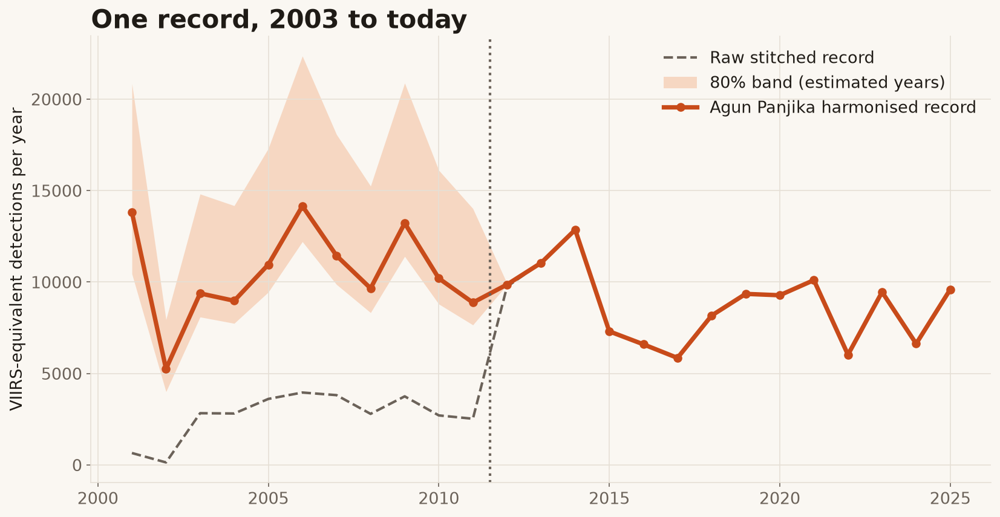<br/>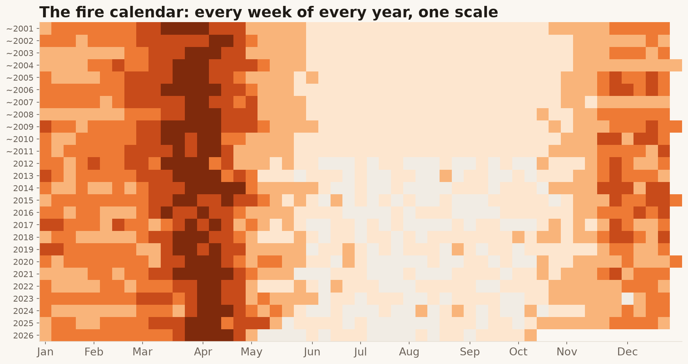</td>
</tr>
</table>

## 7. Is it right? Validation

Every model is tested **leave-one-year-out** over 2012–2025: fit on 13 years, predict the 14th from MODIS alone, and compare with what VIIRS really saw.

| Model | Weekly error | vs PRD 4.4× | vs refit factor | Off-season | Off-season years beating factor | Season total | Peak week | Trend direction |
| --- | --: | --: | --: | --: | :-: | --: | --: | --: |
| PRD single factor 4.4× | 61.0 | — | +23% | 26.1 | — | 20.2% | 3.0 d | 61% |
| Single factor, refit per fold (≈3.9) | 49.5 | −19% | — | 28.7 | — | 12.8% | 3.0 d | 61% |
| 12 monthly factors | 43.2 | −29% | −13% | 21.9 | 11 / 14 | 11.9% | 3.0 d | 69% |
| Negative binomial | 44.1 | −28% | −11% | 19.5 | 13 / 14 | 9.7% | 5.0 d | 85% |
| LightGBM (bagged) | 38.7 | −37% | −22% | 15.3 | 14 / 14 | 10.4% | 2.0 d | 92% |
| **Ensemble (shipped)** | **37.0** | **−39%** | **−25%** | **15.9** | **14 / 14** | **9.5%** | **3.0 d** | **85%** |

<table>
<tr>
<td width="50%"></td>
<td width="50%"></td>
</tr>
</table>

| Check | Result |
| --- | --- |
| MODIS 2003–2021 detections | **54,669**, the same as Farukh et al. 2023 |
| NOAA-20 vs S-NPP, 2019–2024 | 61,912 vs 61,553 (0.6%) |
| 80% band coverage (nested leave-one-year-out) | **81%** of weeks, **86%** of years |
| ESA Sentinel-3 / Fire_cci: change at the 2012 switch | **0.95×** ours vs **3.09×** stitched (1.0 = no jump) |
| ESA: year-to-year correlation (estimated years 2003–2011) | **0.93** |
| ESA: seasonal-cycle correlation | **0.98** |
| Handover bridge (held-out season-total error, no correction) | NOAA-20 4.6%, NOAA-21 10.8%; better than any fitted factor |
| Same code on Nepal | −22% vs refit factor, −60% vs 4.4×, off-season 13 / 13, 81% coverage |

Everything here is reproduced by [notebooks/validation.ipynb](notebooks/validation.ipynb) and `python notebooks/figures.py`.

## 8. Early warning

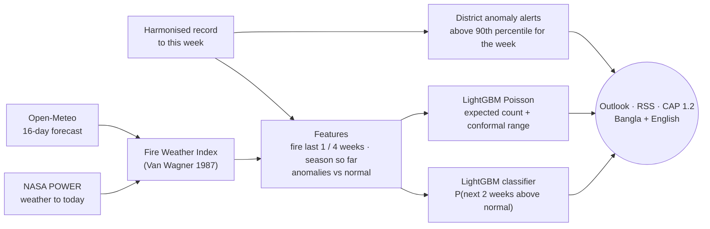

| Two-week outlook, hindcast 2003–2025 | Brier skill vs normal | ROC AUC | Count error (normal-only 59.3) |
| --- | --: | --: | --: |
| Fire history only (floor) | 0.11 | 0.71 | 57.2 |
| With a perfect two-week FWI forecast (upper bound) | **0.21** | **0.77** | **49.2** |

- **What we tested.** Rain, soil wetness and ENSO added no skill. Fire weather did: weeks in the driest fifth of FWI anomaly had **1.65×** normal fire.
- **Season totals.** No method beat the normal range (Brier skill 0.04), so the app shows the normal range instead of a guess.

<table>
<tr>
<td width="55%">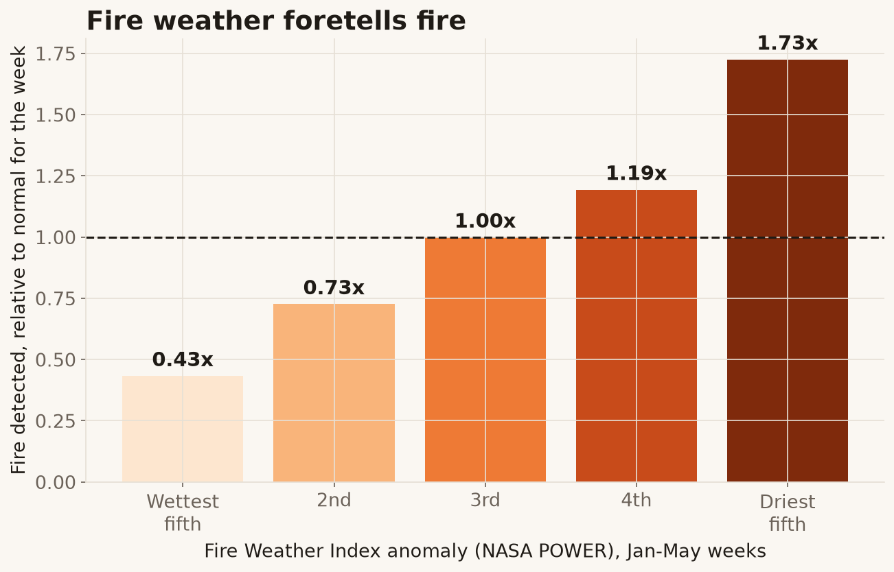</td>
<td width="45%">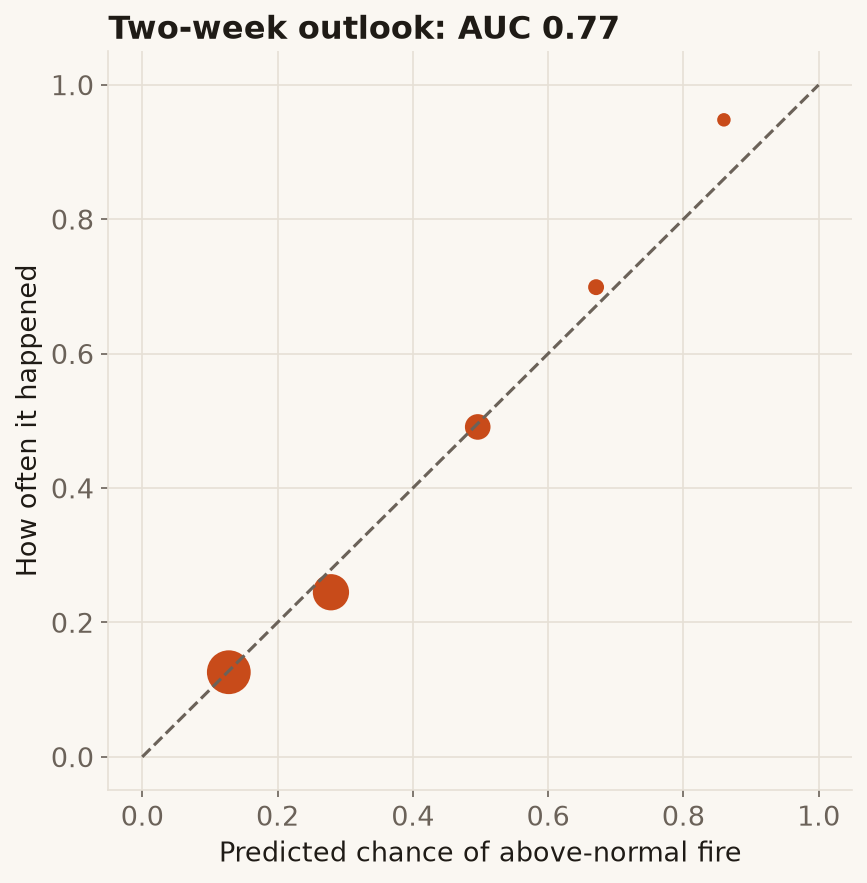</td>
</tr>
</table>

## 9. Kiln and industry filter

Bangladesh has thousands of brick kilns, which look like fires to a satellite. We flag ~400 m cells that burn in many months and years, outside the jhum season. Checking flagged cells by eye on satellite imagery showed one more rule was needed:

> **Industrial heat is seen at night; crop burning is seen by day.**

| Round (fresh random 20 cells each) | Rule | Industry / kiln / power / gas / landfill | Unclear | Vegetation | Precision |
| :-: | --- | :-: | :-: | :-: | :-: |
| 1 | PRD rule (4+ months, 3+ years, off-season) | 12 | 1 | 7 | 60% |
| 2 | + mostly night-time detections | 15 | 4 | 1 | 75% |
| 3 | + at least 10 detections | 16 | 2 | 2 | **80%** ✓ |

<p align="center">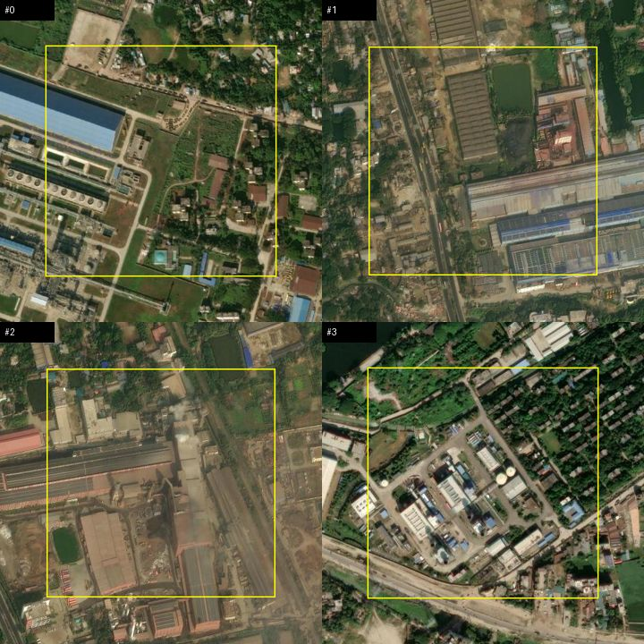<br/><sub>Round-3 flagged cells (yellow box ≈ 400 m): power plants, steel mills, gas facilities. Imagery © Esri, Maxar, Earthstar Geographics.</sub></p>

## 10. Beyond the border

- **Hills.** The hill fire season ignores borders: the Chittagong Hill Tracts, Mizoram, Tripura and Chin State burn in the same weeks.
- **Upwind.** The Borders screen also tracks crop burning across the Indo-Gangetic Plain alongside Dhaka's aerosol (timing only, no blame).

<p align="center">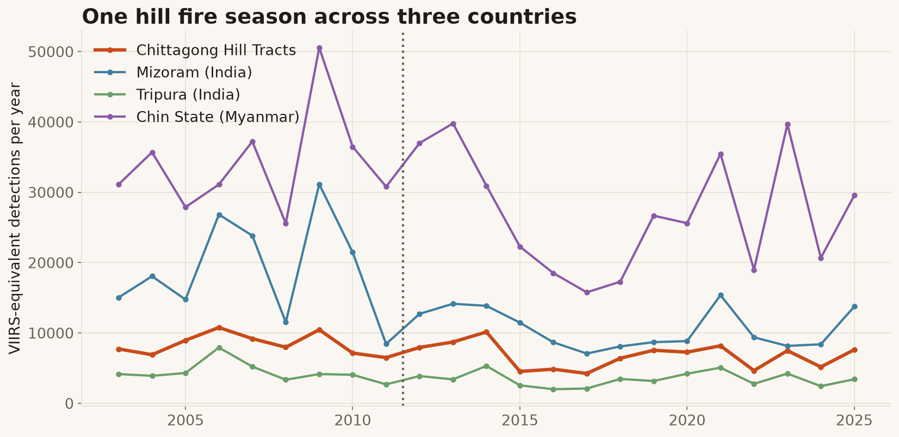</p>

## 11. Run it yourself

```bash
# 1. Pipeline (Python 3.11+)
pip install -e ".[dev]"
echo FIRMS_MAP_KEY=your_key > .env        # free: https://firms.modaps.eosdis.nasa.gov/api/map_key/
python -m pipeline.run_all --api-since 2025-01-01 --neighbours
pytest                                    # 59 tests

# 2. Web app
cd web && npm install && npm run dev      # http://localhost:5173

# 3. Figures and validation
python notebooks/figures.py               # docs/figures/*.png
```

- **The FIRMS key** stays in a gitignored `.env` file and is redacted from logs.
- **Without a key** the pipeline runs on the archive files, which end in 2024.
- **First run** downloads about 1.3 GB; later runs take about 6 minutes.

**Any other country.** Copy [pipeline/countries/npl.json](pipeline/countries/npl.json) and run:

```bash
AP_COUNTRY=pipeline/countries/<iso3>.json python -m pipeline.run_all
```

Outputs go to `build/<iso3>/data/`.

**Deploy.**

1. Add the repository secret `FIRMS_MAP_KEY`.
2. Set Pages to "GitHub Actions".

The daily workflow then refreshes and redeploys the site at 06:00 UTC.

## 12. Repository layout

```text
Harmonic-Fire/
├── pipeline/                 Python pipeline (one module per step)
│   ├── ingest.py             FIRMS country files + throttled area API
│   ├── regions.py  local.py  district / upazila / union tagging and calendars
│   ├── kilns.py              static-source filter (night-time rule)
│   ├── aggregate.py          district × ISO-week tables
│   ├── weather.py            NASA POWER weather, cloud, Dhaka AOD
│   ├── fireweather.py        Canadian Fire Weather Index + 16-day forecast
│   ├── harmonise.py          ensemble, Terra-only model, conformal bands, validation
│   ├── bridge.py             S-NPP → NOAA-20 / NOAA-21
│   ├── climatology.py        normals and alert levels
│   ├── forecast.py           outlooks, alerts, RSS and CAP feeds
│   ├── partner.py            ESA Fire_cci cross-check
│   ├── neighbours.py         cross-border and upwind views
│   ├── export.py             static JSON / CSV contract
│   ├── countries/            any-country configs (Nepal example)
│   └── schema/               JSON schema of the region document
├── web/                      React 18 + Vite + TypeScript app
│   ├── src/screens/          This season · Outlook · Calendar · Sensors · Map · Borders · Method
│   ├── src/components/       charts, calendar, outlook, sonification, share
│   ├── src/i18n/             en.json · bn.json
│   └── public/data/          pipeline output served to the app
├── tests/                    pipeline, early-warning and contrast tests
├── notebooks/                validation.ipynb · figures.py · hero.py
├── docs/                     PRD, plan, video ideas, user-test protocol, kiln checks,
│                             figures/ and screenshots/
└── .github/workflows/        daily refresh and deploy
```

## 13. Limits

- **Estimated years.** Values for 2001–2011 are estimates with 80% bands, not observations. 2001 to mid-2002 rest on Terra alone.
- **Peak weeks.** The year-to-year peak VIIRS/MODIS ratio swings from 2.9× to 7.1×, and MODIS cannot fully see why. That is where most of the remaining error is.
- **Outlooks.** They describe how much fire satellites are likely to detect in an area. They do not predict individual fires.
- **Small areas.** Upazila and union values are shares of the district record; read the pattern, not single weeks.
- **Out of scope.** We do not monitor the Sundarbans, and we do not claim that hill fires or upwind burning cause Dhaka's haze.
- **Language review.** Bangla strings and union names still need native-speaker and CHT community review.

## 14. Credits and citation

**Data**

- NASA FIRMS (MODIS C6.1; VIIRS 375 m S-NPP, NOAA-20, NOAA-21)
- NASA POWER
- ESA Fire_cci (CEDA)
- geoBoundaries (CC BY 4.0)
- OpenFreeMap / OpenMapTiles / OpenStreetMap
- Open-Meteo
- NOAA CPC ONI
- Kiln-check imagery: Esri World Imagery

**Science**

- Farukh, Islam & Hayasaka 2023, *Atmosphere* 14(1):97
- Zheng et al. 2026, *Remote Sensing* 18:1650 (prior MODIS/VIIRS fusion)
- Van Wagner 1987, Canadian FWI System

```text
KUETaguns (2026). Agun Panjika: a harmonised MODIS and VIIRS fire record and early-warning system for
Bangladesh, 2001 to present. NASA Space Apps Challenge 2026. Data: NASA FIRMS, NASA POWER, ESA Fire_cci.
```

<div align="center">
<sub>Made in Khulna for the hills, the forests and the cities that breathe their smoke.<br/>
Product spec: <a href="docs/Agun%20Panjika%20—%20Product%20Requirements%20Document.md">PRD</a> · Video and story ideas: <a href="docs/Agun%20Panjika%20—%20Video%20and%20Story%20Ideas.md">docs</a></sub>
</div>
